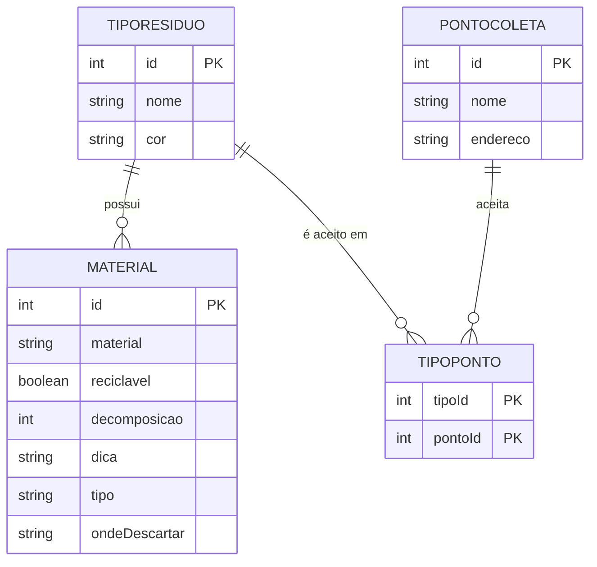

# Lista de Entidades e Atributos

**Projeto 3 · Guia de Coleta Seletiva do Bairro**
Cliente: Associação de Moradores do Jardim Camila
FATEC ZL · Análise e Desenvolvimento de Sistemas · Projeto Desafio 01

Regra usada: substantivo vira entidade, característica vira atributo, verbo que liga dois substantivos vira relação.

---

## 1. Entidades

### Entidade: Material

Item que o morador quer descartar (ex.: caixa de leite, garrafa PET).

| Atributo      | Tipo             | Identificador?  | Observação                                                        |
|---------------|------------------|-----------------|-------------------------------------------------------------------|
| id            | número           | Sim             | gerado automaticamente                                            |
| material      | texto            | Não             | nome do item, obrigatório                                         |
| reciclavel    | verdadeiro/falso | Não             | `true` se pode ir para a coleta seletiva                          |
| decomposicao  | número           | Não             | tempo aproximado de decomposição, em anos                         |
| dica          | texto            | Não             | orientação de preparo antes do descarte                           |
| tipo          | texto            | Não             | referência ao nome do **TipoResiduo** (o material possui um tipo) |
| ondeDescartar | texto            | Não             | atributo derivado: nomes dos **PontoColeta** que aceitam o tipo do material, separados por " e " (guardado como texto no array, conforme o brief) |

### Entidade: TipoResiduo

Categoria do resíduo, que define o filtro e a cor oficial da coleta seletiva.

| Atributo | Tipo   | Identificador? | Observação                                                               |
|----------|--------|----------------|--------------------------------------------------------------------------|
| id       | número | Sim            | gerado automaticamente                                                   |
| nome     | texto  | Não            | Papel, Plástico, Vidro, Metal, Orgânico ou Rejeito                       |
| cor      | texto  | Não            | cor oficial associada ao tipo (calculada no JavaScript a partir do nome) |

Valores de cor:

| nome     | cor      |
|----------|----------|
| Papel    | azul     |
| Plástico | vermelho |
| Vidro    | verde    |
| Metal    | amarelo  |
| Orgânico | marrom   |
| Rejeito  | cinza    |

### Entidade: PontoColeta

Local ou forma de descarte onde o material deve ser entregue.

| Atributo | Tipo   | Identificador? | Observação                            |
|----------|--------|----------------|---------------------------------------|
| id       | número | Sim            | gerado automaticamente                |
| nome     | texto  | Não            | ex.: "Ecoponto da Rua das Flores"     |
| endereco | texto  | Não            | opcional para descartes porta a porta |

### Entidade: TipoPonto

Entidade associativa que resolve a relação N para N entre TipoResiduo e PontoColeta (quais tipos de resíduo cada ponto aceita).

| Atributo | Tipo   | Identificador?       | Observação                   |
|----------|--------|----------------------|------------------------------|
| tipoId   | número | Sim (parte da chave) | referência a **TipoResiduo** |
| pontoId  | número | Sim (parte da chave) | referência a **PontoColeta** |

---|---|---|---|
| materialId | número | Sim (parte da chave) | referência a **Material** |
| pontoId | número | Sim (parte da chave) | referência a **PontoColeta** |

---

## 2. Relações

- Um **Material** possui um **TipoResiduo**. (N para 1)
- Um **TipoResiduo** possui vários **Materiais**. (1 para N)
- Um **TipoResiduo** pode ser aceito em vários **PontosColeta**. (N para N)
- Um **PontoColeta** aceita vários **TiposResiduo**. (N para N)

A relação N para N é resolvida pela entidade associativa **TipoPonto**: cada linha liga um TipoResiduo a um PontoColeta que o aceita. Assim, o ponto onde um material deve ser descartado é consequência do tipo dele (ex.: todo material do tipo Vidro vai para o Ecoponto).

### Diagrama

---

## 3. Como o modelo aparece no `dados.js`

O brief pede um único array de objetos. Por isso, no `dados.js`, cada objeto representa um **Material** e traz o nome do **TipoResiduo** (`tipo`) e do **PontoColeta** (`ondeDescartar`) escritos como texto.

| Entidade    | Onde aparece no código                                                                                                      |
|-------------|-----------------------------------------------------------------------------------------------------------------------------|
| Material    | cada objeto do array `MATERIAIS`                                                                                            |
| TipoResiduo | propriedade `tipo` (o nome é a chave usada para filtrar e para escolher a cor no JavaScript)                                |
| PontoColeta | propriedade `ondeDescartar`, que pode listar mais de um ponto no mesmo texto                                                |
| TipoPonto   | não existe como estrutura própria; a ligação está implícita: todos os materiais do mesmo `tipo` têm o mesmo `ondeDescartar` |

Na segunda metade do semestre, quando o modelo virar banco de dados, `tipo` vira uma chave estrangeira (`tipo_id`) em `Material`, e `ondeDescartar` deixa de ser guardado: os pontos passam a ser consultados pela tabela `TipoPonto`, a partir do tipo do material. Isso evita repetir texto em cada linha.

---

