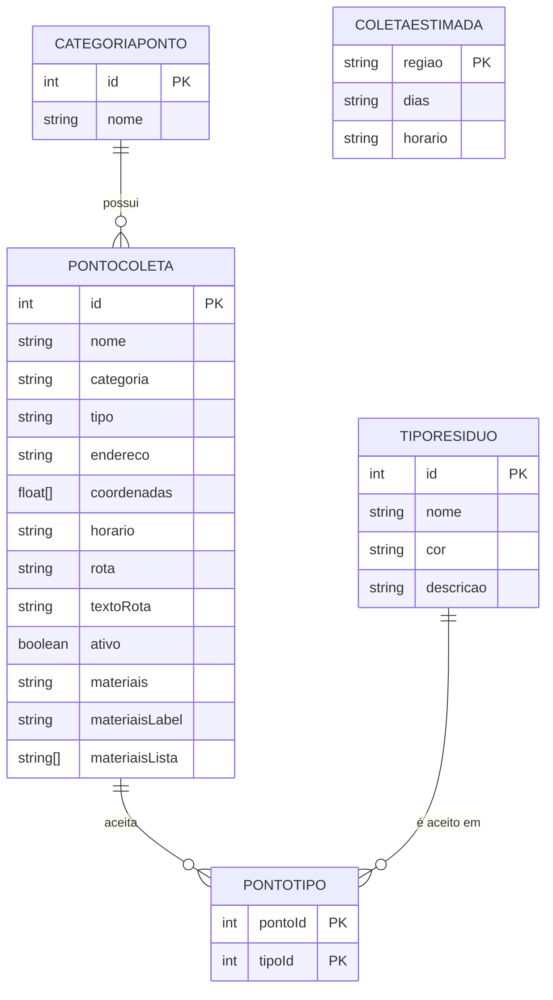

# Lista de Entidades e Atributos

**Projeto 3 · Guia de Coleta Seletiva do Bairro**
Time WizTech · Cliente (fictício): Associação de Moradores do Jardim Camila
FATEC ZL · Análise e Desenvolvimento de Sistemas · Projeto Desafio 01

Regra usada: substantivo vira entidade, característica vira atributo, verbo que liga dois substantivos vira relação.

---

## 1. Entidades

### Entidade: PontoColeta

Local onde o morador pode descartar resíduos (ecoponto, PEV ou ponto específico). Cada ponto aparece no mapa.

| Atributo | Tipo | Identificador? | Observação |
|---|---|---|---|
| id | número | Sim | gerado automaticamente |
| nome | texto | Não | obrigatório, ex.: "Ecoponto Vila Matilde" |
| categoria | texto | Não | referência a **CategoriaPonto**: "ecoponto", "pev" ou "especifico" |
| tipo | texto | Não | descrição do ponto, ex.: "Ecoponto municipal", "Ponto de entrega voluntária" |
| endereco | texto | Não | obrigatório |
| coordenadas | lista de 2 números | Não | [latitude, longitude], usadas para posicionar o ícone no mapa |
| horario | texto | Não | ex.: "Segunda a sábado, das 8h às 17h" |
| rota | texto | Não | link para ver a localização no Google Maps |
| textoRota | texto | Não | opcional, texto do link de rota |
| ativo | verdadeiro/falso | Não | se o ponto deve aparecer no mapa |
| materiais | texto | Não | opcional (PEV): materiais aceitos, em texto corrido |
| materiaisLabel | texto | Não | opcional (ponto específico): título da lista de materiais |
| materiaisLista | lista de textos | Não | opcional (ponto específico): materiais coletados |

### Entidade: CategoriaPonto

Classificação do ponto, usada para escolher o ícone no mapa.

| Atributo | Tipo | Identificador? | Observação |
|---|---|---|---|
| id | número | Sim | gerado automaticamente |
| nome | texto | Não | "ecoponto", "pev" ou "especifico" |

### Entidade: TipoResiduo

Tipo de resíduo da coleta seletiva, que define o filtro, a descrição exibida no fim da página e a cor oficial.

| Atributo | Tipo | Identificador? | Observação |
|---|---|---|---|
| id | número | Sim | gerado automaticamente |
| nome | texto | Não | Papel, Plástico, Vidro, Metal, Orgânico ou Rejeito |
| cor | texto | Não | cor oficial do tipo, definida pelo JavaScript a partir do nome |
| descricao | texto | Não | explicação do que entra e do que não entra no tipo |

Cores oficiais:

| nome | cor |
|---|---|
| Papel | azul |
| Plástico | vermelho |
| Vidro | verde |
| Metal | amarelo |
| Orgânico | marrom |
| Rejeito | cinza |

### Entidade: PontoTipo

Entidade associativa que resolve a relação N para N entre PontoColeta e TipoResiduo (quais tipos cada ponto aceita).

| Atributo | Tipo | Identificador? | Observação |
|---|---|---|---|
| pontoId | número | Sim (parte da chave) | referência a **PontoColeta** |
| tipoId | número | Sim (parte da chave) | referência a **TipoResiduo** |

### Entidade: ColetaEstimada

Dias e horários estimados da coleta seletiva porta a porta, por região.

| Atributo | Tipo | Identificador? | Observação |
|---|---|---|---|
| regiao | texto | Sim | "Sul", "Centro" ou "Norte" |
| dias | texto | Não | ex.: "quarta e sábado" |
| horario | texto | Não | ex.: "das 13h às 16h" |

---

## 2. Relações

- Um **PontoColeta** pertence a uma **CategoriaPonto**. (N para 1)
- Uma **CategoriaPonto** possui vários **PontosColeta**. (1 para N)
- Um **PontoColeta** aceita vários **TiposResiduo**. (N para N)
- Um **TipoResiduo** é aceito em vários **PontosColeta**. (N para N)

A relação N para N é resolvida pela entidade associativa **PontoTipo**: cada linha liga um PontoColeta a um TipoResiduo que ele aceita.

**ColetaEstimada** não se relaciona com as demais entidades nesta versão: os dados trazem a região apenas como texto, sem ligação com as coordenadas dos pontos.

### Diagrama

---

## 3. Como o modelo aparece no `dados.js`

| Entidade | Onde aparece no código |
|---|---|
| PontoColeta | cada objeto do array `pontos` dentro de `DADOS_MAPA` (15 objetos) |
| CategoriaPonto | propriedade `categoria` de cada ponto |
| TipoResiduo | nome, cor e descrição de cada tipo ficam fora do `dados.js` enviado |
| PontoTipo | ligação implícita nos textos `materiais` e `materiaisLista` |
| ColetaEstimada | array `coletaEstimada` dentro de `DADOS_MAPA` (3 objetos) |

As configurações do mapa (`centro`, `zoomInicial`, `limites`, `tiles` etc.) são parâmetros de exibição e não entidades do modelo.

Na segunda metade do semestre, quando o modelo virar banco de dados, `categoria` vira uma chave estrangeira (`categoria_id`) em `PontoColeta`, e os textos de materiais passam a ser linhas da tabela `PontoTipo`.

---

## 4. Observações

- A entrevista com o cliente é fictícia, com autorização do professor.
- Os dias e horários de coleta (`coletaEstimada`) são estimativas.
- Os pontos de coleta representados no mapa estão na região de Artur Alvim e arredores.
