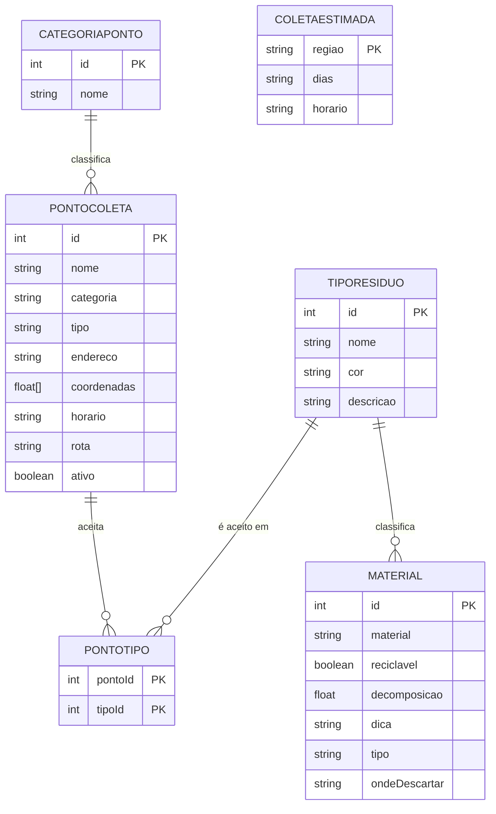

# Lista de Entidades e Atributos

**Projeto 3 · Guia de Coleta Seletiva do Bairro**  
Time WizTech · Cliente (fictício): Associação de Moradores de Artur Alvim
FATEC ZL · Análise e Desenvolvimento de Sistemas · Projeto Desafio 01

Regra usada: substantivo vira entidade, característica vira atributo, verbo que liga dois substantivos vira relação.

---

## 1. Entidades

### Entidade: Material

Item que o morador quer descartar (ex.: caixa de leite, garrafa PET).

| Atributo | Tipo | Identificador? | Observação |
|---|---|---|---|
| id | número | Sim | identificador do material |
| material | texto | Não | nome do item |
| reciclavel | verdadeiro/falso | Não | indica se pode ir para a coleta seletiva |
| decomposicao | número | Não | tempo aproximado de decomposição, em anos |
| dica | texto | Não | orientação de preparo antes do descarte |
| tipo | texto | Não | nome do **TipoResiduo** ao qual o material pertence |
| ondeDescartar | texto | Não | orientação de descarte; pode listar mais de um local |

### Entidade: TipoResiduo

Categoria do resíduo, usada para filtrar os materiais e definir a cor do cartão.

| Atributo | Tipo | Identificador? | Observação |
|---|---|---|---|
| id | número | Sim | identificador da categoria |
| nome | texto | Não | Papel, Plástico, Vidro, Metal, Orgânico ou Rejeito |
| cor | texto | Não | cor associada ao tipo, aplicada pelo CSS conforme o nome |
| descricao | texto | Não | explicação sobre os materiais incluídos no tipo |

Cores dos cartões:

| Nome | Cor |
|---|---|
| Papel | azul |
| Plástico | vermelho |
| Vidro | verde |
| Metal | amarelo |
| Orgânico | marrom |
| Rejeito | cinza |

### Entidade: PontoColeta

Local ou forma onde o morador pode descartar resíduos. Os pontos físicos aparecem no mapa.

| Atributo | Tipo | Identificador? | Observação |
|---|---|---|---|
| id | número | Sim | identificador do ponto |
| nome | texto | Não | ex.: "Ecoponto Vila Matilde" |
| categoria | texto | Não | referência a **CategoriaPonto** |
| tipo | texto | Não | descrição do ponto, ex.: "Ecoponto municipal" |
| endereco | texto | Não | endereço do ponto |
| coordenadas | lista de 2 números | Não | [latitude, longitude] |
| horario | texto | Não | horário de funcionamento |
| rota | texto | Não | link para localização no Google Maps |
| textoRota | texto | Não | opcional, rótulo do link de rota |
| ativo | verdadeiro/falso | Não | indica se o ponto deve aparecer no mapa |
| materiais | texto | Não | opcional: materiais aceitos pelo ponto |
| materiaisLabel | texto | Não | opcional: título da lista de materiais |
| materiaisLista | lista de textos | Não | opcional: materiais coletados |
| mudancasPrevistas | verdadeiro/falso | Não | indica se há mudança prevista |
| mudancaPrevista | texto | Não | descrição opcional da mudança prevista |

### Entidade: CategoriaPonto

Classificação do ponto, usada para filtrar pontos e escolher o ícone do mapa.

| Atributo | Tipo | Identificador? | Observação |
|---|---|---|---|
| id | número | Sim | identificador da categoria |
| nome | texto | Não | "ecoponto", "pev" ou "especifico" |

### Entidade: PontoTipo

Entidade associativa que representa quais tipos de resíduo cada ponto aceita.

| Atributo | Tipo | Identificador? | Observação |
|---|---|---|---|
| pontoId | número | Sim (parte da chave) | referência a **PontoColeta** |
| tipoId | número | Sim (parte da chave) | referência a **TipoResiduo** |

### Entidade: ColetaEstimada

Dias e horários estimados da coleta seletiva porta a porta, por região.

| Atributo | Tipo | Identificador? | Observação |
|---|---|---|---|
| regiao | texto | Sim | "Sul", "Centro" ou "Norte" |
| dias | texto | Não | dias estimados da coleta |
| horario | texto | Não | horário estimado da coleta |

---

## 2. Relações

- Um **Material** pertence a um **TipoResiduo**. (N para 1)
- Um **TipoResiduo** classifica vários **Materiais**. (1 para N)
- Um **PontoColeta** pertence a uma **CategoriaPonto**. (N para 1)
- Uma **CategoriaPonto** classifica vários **PontosColeta**. (1 para N)
- Um **PontoColeta** pode aceitar vários **TiposResiduo**. (N para N)
- Um **TipoResiduo** pode ser aceito em vários **PontosColeta**. (N para N)

A relação N para N entre **PontoColeta** e **TipoResiduo** é representada por **PontoTipo**. Na versão atual dos dados, essa ligação não é armazenada como uma tabela própria: aparece nos textos `materiais`, `materiaisLista` e `ondeDescartar`.

`ondeDescartar` é uma orientação textual presente nos materiais, não uma chave estrangeira para `PontoColeta`. Ela também pode indicar formas de descarte sem ponto físico, como "Lixo comum" e "Composteira da Associação".

**ColetaEstimada** não possui ligação explícita com os pontos nesta versão; a região é informada como texto e a estimativa é selecionada pela posição do clique dentro do limite de Artur Alvim.

### Diagrama

---

## 3. Como o modelo aparece no `dados.js`

`dados.js` define o objeto `DADOS_MAPA`. Os arrays `pontos`, `materiais` e `coletaEstimada` contêm os registros usados pelo site.

| Entidade | Onde aparece no código |
|---|---|
| Material | cada objeto do array `DADOS_MAPA.materiais` |
| TipoResiduo | propriedade `tipo` de cada material; o nome seleciona o filtro e a cor do cartão |
| PontoColeta | cada objeto do array `DADOS_MAPA.pontos` (15 objetos) |
| CategoriaPonto | propriedade `categoria` de cada ponto |
| PontoTipo | relação implícita nas propriedades `materiais` e `materiaisLista` dos pontos |
| ColetaEstimada | array `DADOS_MAPA.coletaEstimada` (3 objetos) |

O array `materiais` também contém `ondeDescartar`, `reciclavel`, `decomposicao` e `dica`, exibidos nos cartões pesquisáveis e filtráveis por tipo. As configurações do mapa (`centro`, zoom, tiles e limites) são parâmetros de exibição. O limite de Artur Alvim é armazenado como coordenadas locais em `DADOS_MAPA.limiteArturAlvim.coordenadas`, derivadas da relação 3049500 do OpenStreetMap.

Na implementação atual, `TipoResiduo`, `CategoriaPonto` e `PontoTipo` são conceitos do modelo, não tabelas ou arrays independentes. Se o projeto migrar para banco de dados, `Material.tipo` pode virar uma chave estrangeira para `TipoResiduo`; os tipos aceitos por cada ponto podem ser armazenados em `PontoTipo`, evitando repetir informações textuais.

---

## 4. Observações

- A entrevista com o cliente é fictícia, com autorização do professor.
- Os dias e horários de coleta são estimativas.
- Os pontos de coleta representados no mapa estão na região de Artur Alvim e arredores.
- A geometria do limite é baseada em dados do OpenStreetMap (relação 3049500); os dados são © OpenStreetMap contributors, sob licença ODbL.
